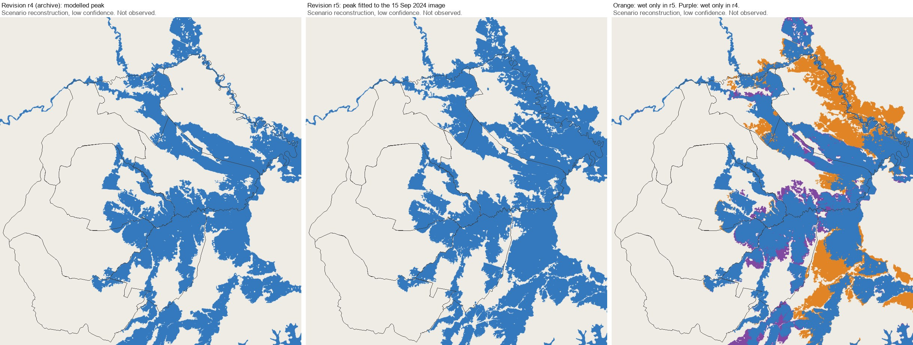

# The replay's peak fitted to the image of 15 September 2024 (revision r5)

Written 12 October 2026. Plan and its amendment:
`docs/proposal_execution/replay_river_fit_plan_v1.md`. Decision log: R48.

**Label of everything on this page:** scenario reconstruction, low confidence.
The modelled water is not an observation of a flood, not real-time and not an
official warning. The replay computes no priority score and no action class.

## What changed

Up to revision r4 one rule set how high the water stood along every stream at
the peak: the level at the Sai bridges (3.5 m), scaled down by the area a
stream drains. From revision r5 the peak level of each stretch of channel is
fitted to what the Sentinel-2 image of 15 September 2024 shows: ground that
was green on 5 September and on 15 September was brown without plants (mud)
or still wet. A stretch with too little such ground within 1 km keeps the old
rule. On the other days every stretch rises and falls in step with the level
at the bridges, as before. The stage curve over time was not changed.

The rule in numbers is in the replay's manifest, `river_fit`
(`apps/web/public/studies/mae-sai-2024-timeline/r5/timeline.json`), and the
code is `src/floodguard/replay_river_fit.py`.

## The two peaks



Drawn by `scripts/draw_replay_peaks.py` from the two committed revisions. On
the whole model grid, both banks of the border, about 135 km² are wet in both
peaks, about 46 km² only in r5 and about 14 km² only in r4. The largest gain
is the strip along the border river in the north-east, on both banks; the
largest loss is at the edges of the plain in the south.

| At the modelled peak | r4 | r5 |
|---|---|---|
| Flooded area in the district | 88.7 km² | 98.3 km² |
| Residents in water | 16,060 | 17,232 |
| Road impassable | 163.8 km | 176.1 km |
| Residents whose homes flood (shelter demand) | 14,169 | 14,428 |

| Subdistrict | Flooded km², r4 | Flooded km², r5 | Residents in water, r4 | Residents in water, r5 |
|---|---|---|---|---|
| Ko Chang | 16.0 | 29.9 | 1,706 | 3,624 |
| Si Mueang Chum | 23.0 | 20.9 | 3,466 | 2,980 |
| Ban Dai | 20.4 | 17.4 | 2,312 | 1,926 |
| Pong Pha | 12.5 | 12.2 | 1,922 | 1,914 |
| Mae Sai | 9.7 | 11.2 | 5,920 | 6,074 |
| Pong Ngam | 4.8 | 4.4 | 435 | 410 |
| Huai Khrai | 1.6 | 1.6 | 197 | 203 |
| Wiang Phang Kham | 0.7 | 0.7 | 102 | 102 |

Ko Chang gains the most: its flooded area nearly doubles and its residents in
water more than double. Si Mueang Chum and Ban Dai lose some.

## How well it follows the image, and the test it failed

| Share of the mud and wet ground of 15 September that the peak covers | Model before the fit | Fitted model |
|---|---|---|
| The whole replay area (27.9 km² of such ground) | 73% | 89% |
| Held-back squares: fitted on the other squares only (16.7 km²) | 73% | 62% |

The first row is not a test: the model was fitted to that ground, so it
follows it. The second row is the test the plan set before any level was
fitted. The area was cut into squares of 2 km like a chessboard, the levels
were fitted on one colour and read on the other. There the fitted model
covers less of the mud than the model before it, 62% against 73%. The plan
said the earlier model would stay in that case. The owner chose the fitted
one on 12 October 2026 and the plan records it; the result of the test is in
the manifest and on the replay page, above the map.

What this means:

- Where the image of 15 September sees the ground, the peak of r5 is closer
  to the mud line than the peak of r4.
- Where the image does not see (cloud, forest, ground that was bare before
  the flood) and on a stretch with no mud of its own, r5 is not shown to be
  better than r4, and the test says a level borrowed from elsewhere is worse.
- The fit is to the peak only. It gives no evidence on the hours of rise and
  fall.

## What is no longer an independent check

Three comparisons on the replay page change their label with r5:

- The Sentinel-2 mud line and the Sentinel-2 water check: used for tuning.
- UNOSAT and GISTDA product 4009 (the season layer): no level is fitted to
  it, but its comparison with the two models was known when the fitted one
  was chosen and was one of the reasons, so it is calibration-informed. Its
  agreement with the peak is 0.54 with r5 and was 0.48 with r4.
- The Sentinel-1 radar pass of 16 September was already calibration-informed.
  With r5 the same-track pair still fits best at 0.10 m and the cross-track
  pair at 0.15 m; the keyframes were not changed again.

The reported depths from the news are still never used for tuning. With r5
the model is dry at 10 of the 21 place records (9 with r4).

**One located report got worse.** At Piyaphon village, off Mueang Daeng Road
in the town, a resident reported chest-deep water on the night of 10 to 11
September. With r4 the model had 0.78 m of water there in the report's time
window and 2.4 m at the peak. With r5 it has none in the window and 0.1 m at
the peak: the level fitted along that stretch is about 1.2 m, where the old
rule gave 3.5 m. The fit reads ground that was green before the flood, and
built-up ground was not, so in the town a level rests on little evidence or on
the fields beside it. The other 20 place records read as before. A variant
that never lets a fitted level fall below the level of r4 would keep this
report wet; it was set aside in the plan because it also keeps water where
the image shows none. It is the first thing to try if the town is to be shown
in detail.

## What did not change

- Case SE1, its eight classes and every published planning file. The replay
  feeds no planning score.
- The stage keyframes, the surface model, the roads, the residents and the
  shelter list.

## The archive

Revision r4 is kept unchanged:

- on the site at `/archive1/`, marked "Archived replay (revision r4)" above
  the map, with a link to the current replay;
- in Git as tag `replay-r4` and as the folder
  `apps/web/public/studies/mae-sai-2024-timeline/r4/`.

The archive is not in the offline copy of the site; it loads when the page is
opened with a connection.

## What follows from the new figures elsewhere

- `docs/demo/replay_numbers.md` was written again from r5; the spoken lines
  of `docs/demo_walkthrough.md` and the fallback video
  (`docs/demo/mae-sai-replay-demo.mp4`) were made again from r5.
- The Evacuation Equity Gap of the plan of 8 at the peak reads 1.74 with r5
  (1.61 with r4): 320 of 373 proxy-vulnerable residents against 12,060 of
  24,444 others.
- `docs/studio-study-library.md` and `docs/command_exercise_plan.md` describe
  the page with the figures of r4; each says so at the place.
- The policy page names r5 as the current replay: only the name of the
  revision was changed there, on the owner's word of 12 October.

## To make the figures again

```text
python scripts/build_mae_sai_flood_timeline.py --external-root <external data root> --generated-at 2026-10-12T06:00:00Z
python scripts/build_replay_numbers.py
python scripts/draw_replay_peaks.py
```

The first command needs the rasters outside Git and the `pysheds` package;
the other two read committed files only.
