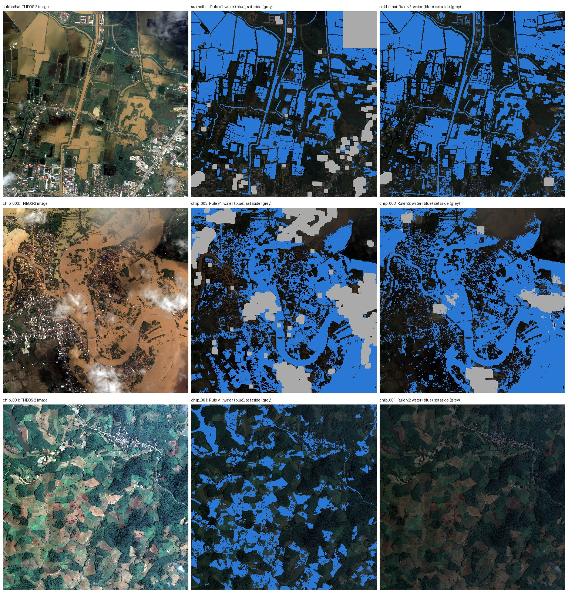

# A sturdier THEOS-2 water rule (rule v2)

**State on 11 October 2026: the rule is chosen and frozen. It has not been
scored on the 300 test points yet; that happens once, when two team members
have labelled them.**

Plan: `docs/proposal_execution/theos2_water_rule_v2_plan_v1.md`.
Freeze record: `outputs/theos2_water_rule_v2/freeze_v1.json`.
Code: `floodguard.theos2_water_rule_v2.water_v2`.

## What was wrong with rule v1

Rule v1 is the rule behind every THEOS-2 check so far. It splits the water
index of each image into three groups and calls the upper group water.

1. **It always finds water.** On the chip without a flood it called 23
   percent of the chip water: bare soil. A person had to set the chip aside.
2. **It sets a large area aside.** Bright objects count as unobservable: 19
   percent of the chip of the flooded town, much of it bright muddy water.
3. **It needed settings made by eye**: a rectangle, an object size.

## The rule

> A pixel of 2 m is water when its near-infrared value is below its red
> value: (NIR − red) / (NIR + red) at or below −0.01.
>
> Inside a bright object at least 80 m wide, a pixel with that index above
> −0.04 is unobservable (cloud). A pixel below it is bright muddy water and
> stays water.

Water takes up near infrared, so over water the near-infrared value falls
below the red one, also when the water is brown with mud. Plants and soil do
the opposite. The limit is the same for every image: nothing is found on the
image, no object is dropped for its size, and nothing is set by eye. The
index is the one known as NDVI, read from its low end.

## How it was chosen

On 240 development points, drawn like the test points with another seed and
none within 20 m of one. **The agent that built the rule labelled them** (an
AI model), from sheets that show a number and three pictures and no group:
83 water, 117 not water, 40 cannot tell. They are development data, not a
reference.

The figure a candidate is chosen by: of the area where the label is water or
not water, the share where the candidate gives an answer and the answer is
the label. Area a candidate sets aside counts against it. A candidate with a
fitted value is scored on each chip by a version fitted without that chip.

| Candidate | Sukhothai | Flooded town | No flood | Mean |
|---|---:|---:|---:|---:|
| Rule v1 | 0.83 | 0.74 | 0.77 | 0.78 |
| NIR at or below red, no fitted value | 0.91 | 0.94 | 1.00 | 0.95 |
| **Index at or below a fitted limit** (the limit came out at −0.01 on every pair of chips) | **0.93** | **0.97** | **1.00** | **0.97** |
| The water index of rule v1 with one limit for every image (best of three) | 0.87 | 0.92 | 1.00 | 0.93 |
| Logistic regression on three or four colour indices (best of eight) | 0.93 | 0.93 | 1.00 | 0.95 |
| Decision tree, depth 3 (best of four) | 0.93 | 0.96 | 1.00 | 0.96 |

**The simplest candidate with a fitted value won.** The trained classifiers
did not beat one limit on one index, and with 240 points there is no case for
them. Every candidate and its score is in the freeze record.

The cloud rule was chosen outside this figure, and that is an addition to the
plan: a point under cloud has no label to score against, so the figure cannot
see whether cloud is set aside. Of the five development points the agent
marked as cloud, the frozen rule sets four aside; without a cloud rule three
of the five would be called water. It rests on five points.

## What changes on the three chips

| Chip | Water, rule v1 | Water, rule v2 | Set aside, rule v1 | Set aside, rule v2 |
|---|---:|---:|---:|---:|
| Sukhothai | 34% | 42% | 8.5% | 0.6% |
| Flooded town | 38% | 45% | 18.7% | 5.2% |
| No flood | 23% | 0.0% | 0% | 0% |

The picture is for looking, not a measurement. What it shows, both ways:

- On the chip without a flood, rule v2 calls nothing water. That includes
  the river in the upper left corner, which it misses.
- In the south of the Sukhothai chip, rule v2 marks roads and roofs as water
  in places: grey surfaces have an index just below zero.
- On the chip of the flooded town, thin cloud at the edge of thick cloud is
  called water in places.

## What happens next

1. Two team members label the 300 test points
   (`docs/theos2_water_label_check.md`).
2. One run scores rule v1 and rule v2 on them, and writes whether rule v2 is
   better, with an interval for the difference. If the interval reaches zero
   the sentence is "not shown to be better".
3. No earlier figure is replaced. The radar comparisons at Sukhothai and on
   the held-out chip stay as reported, against rule v1.
4. Whether the images of Mae Sai are read with rule v1 or rule v2 is decided
   after step 2, by an amendment of the plan for those images, committed
   before any of them is opened.

## Limits

- The development labels are the reading of an AI model on the same four
  bands the rule reads.
- The test points lie on the same three images the rule was developed on.
  How the rule does on a new image is only estimated by leaving one chip
  out, on the agent's labels.
- Three chips, two of them from one pass. None shows Mae Sai, a mountain
  valley or terrain shadow.
- The two brightness limits of the cloud rule are raw sensor values taken
  over from rule v1.
- Roofs, roads and concrete are called water in places; thin cloud that is
  not bright is not set aside.
